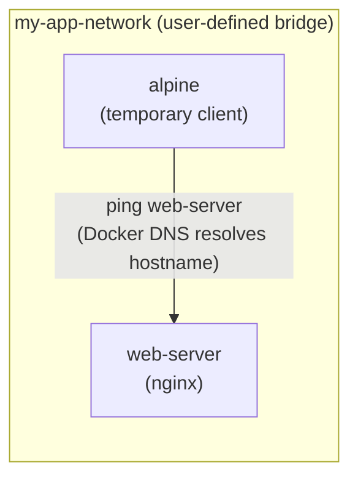
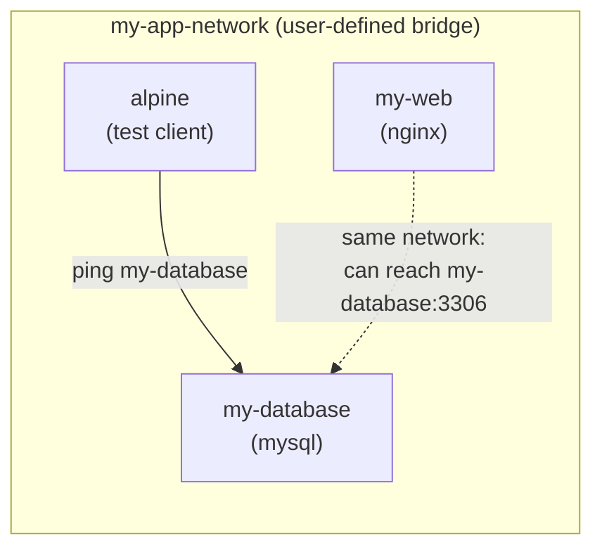

## **🔹 Container Networking Medium-Level Labs**
### **🛠 Lab 1: Creating a Multi-Container Network with Communication**  
**Objective:** Set up a **custom bridge network** where two containers communicate using hostnames.  

#### **Network Topology:**


#### **Steps:**
1. **Create a user-defined network**  
   ```sh
   docker network create my-app-network
   ```
2. **Run a web application (Nginx) inside the network**  
   ```sh
   docker run -d --name web-server --network my-app-network nginx
   ```
3. **Run a second container (Alpine) and test communication**  
   ```sh
   docker run -it --rm --network my-app-network alpine ping -c 4 web-server
   ```
4. **Expected Output:**  
   ✅ The Alpine container should be able to **ping web-server** successfully.

---

### **🛠 Lab 2: Running an Application with a Database on a Custom Network**  
**Objective:** Deploy a **web application (Nginx) and a database (MySQL)** on a **custom bridge network** to simulate a full-stack application.  

#### **Network Topology:**


#### **Steps:**
1. **Create a custom network**  
   ```sh
   docker network create my-app-network
   ```
2. **Run a MySQL container in the network**  
   ```sh
   docker run -d --name my-database --network my-app-network -e MYSQL_ROOT_PASSWORD=root mysql
   ```
3. **Run an Nginx container in the same network**  
   ```sh
   docker run -d --name my-web --network my-app-network nginx
   ```
4. **Run an Alpine container and check if it can reach MySQL**  
   ```sh
   docker run -it --rm --network my-app-network alpine sh
   ```
5. **Inside the Alpine shell, test the MySQL connection:**  
   ```sh
   ping my-database
   ```
6. **Expected Output:**  
   ✅ The Alpine container should **ping the MySQL database** successfully.  

---
## License
This project is licensed under the MIT License.

---
## **Contact**
For questions or feedback, feel free to reach out:
- **Email**: eyal@levys.co.il
- **GitHub**: [https://github.com/elevy99927](https://github.com/elevy99927)
