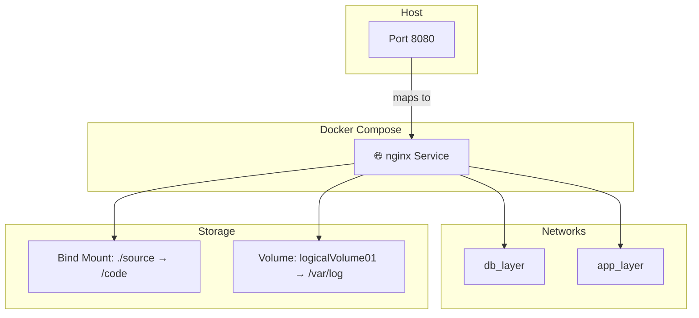

# Docker Compose Example

A simple Docker Compose setup demonstrating basic service configuration with nginx, networking, volumes, and bind mounts.

## Architecture



## Components

| Component | Details |
|-----------|---------|
| **Service** | nginx web server |
| **Port** | 8080:8080 (host:container) |
| **Networks** | db_layer, app_layer |
| **Bind Mount** | ./source → /code |
| **Volume** | logicalVolume01 → /var/log |

## Quick Start

```bash
# Start the services
docker-compose up -d

# View logs
docker-compose logs -f

# Stop services
docker-compose down
```

## File Structure

- `Dockerfile` - Builds the nginx image
- `docker-compose.yml` - Service configuration and orchestration
- `README.md` - This file
